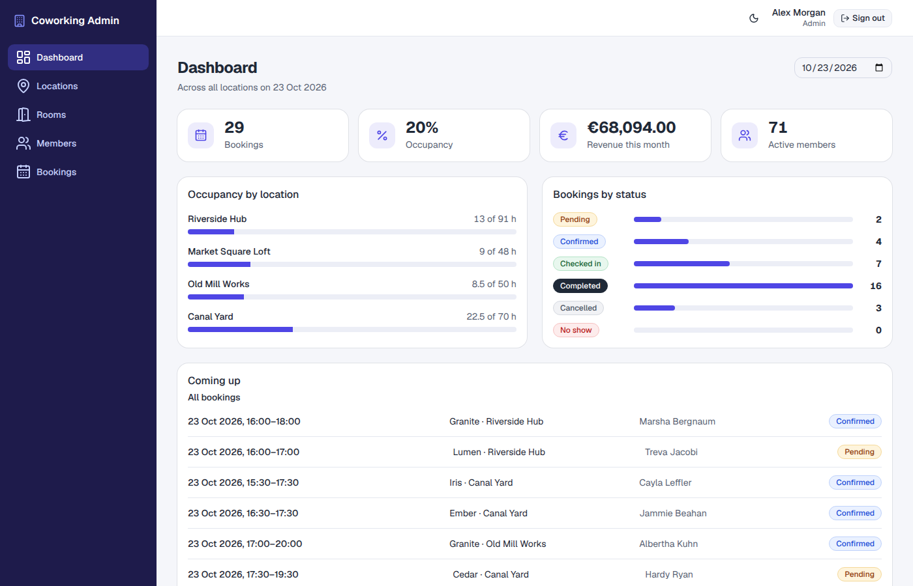
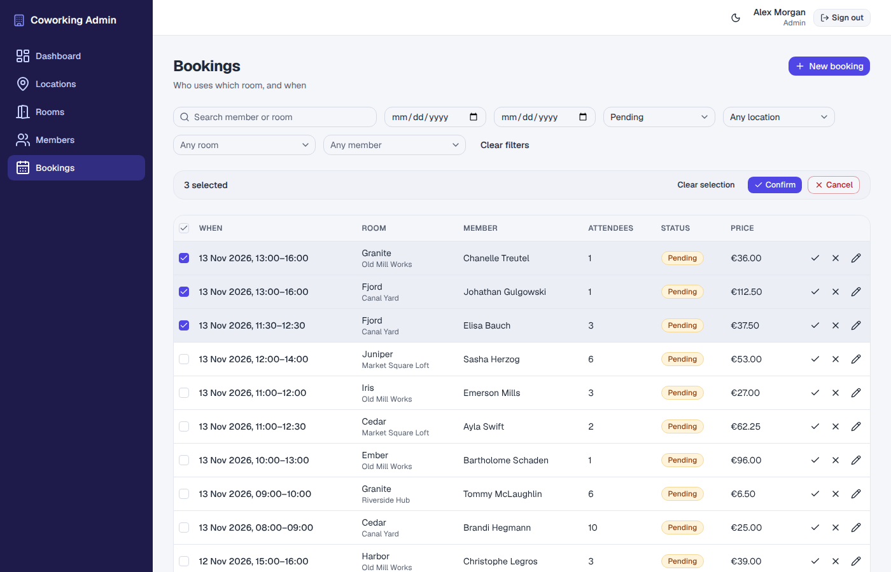
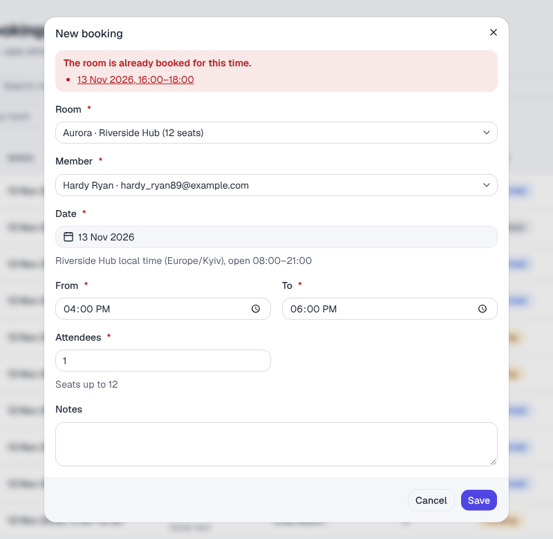

# Coworking Admin

Admin console for a network of coworking spaces: locations, rooms, members and bookings, with a
dashboard of the day's occupancy. A Next.js 16 app (App Router, React 19) in which Next.js is also
the backend-for-frontend: the browser talks to its own `/bff/*` route handlers, which forward to a
REST API with a session token that never reaches client JavaScript. The repository ships a mock
backend, so it runs without any real server.

It is a reference project for the questions a larger admin app has to answer: where the session
lives, how server state is cached and invalidated, where list state lives, how forms agree with the
API, and how layer rules are kept from eroding.



- **Bookings that follow the rules:** at most 8 hours, inside the location's opening hours on its
  own clock, within room capacity. An overlap is refused with the conflicting booking listed, as a
  link, in the form.
- **Status workflow:** `pending → confirmed → checked_in → completed`, plus cancel and no-show, one
  by one or in bulk (up to 100), with a per-booking report of what was refused and why.
- **Lists you can share:** page, size, search and filters live in the URL, so a filtered list
  survives a reload and a bookmark.
- **Errors where they belong:** validation errors under their fields, conflicts in the form,
  everything else in a toast; an expired session goes back to sign-in with a message.
- **Accessible and themed:** axe checks every screen and open dialog in both colour schemes;
  light and dark follow the system setting and can be toggled.

|                                                  |                                                      |
| ------------------------------------------------ | ---------------------------------------------------- |
|                    |        |
| Filtered list with rows ticked for a bulk action | Overlapping booking refused, dialog stays open (409) |

## Quick start

### Full demo in Docker

```bash
docker compose up --build
```

Open http://localhost:8080 and sign in with **admin@coworking.test** / **demo1234**. The mock API
container answers after 150 ms, so loading states are visible. Both ports are published on the
loopback interface only. `docker compose pull && docker compose up` runs the images published to
GHCR instead of building them.

### Local development

Requires Node.js 24 (`.nvmrc`).

```bash
npm ci
npm run dev   # mock API on :4010 and the app on http://localhost:3000
```

`npm run mock` and `npx next dev` run the two halves separately. `.env.development` points the app
at the mock; for anything else copy `.env.example`.

| Variable                       | Used by | Meaning                                                            |
| ------------------------------ | ------- | ------------------------------------------------------------------ |
| `API_URL`                      | app     | Origin of the REST API, no path: the app adds `/api/v1`. Required. |
| `COOKIE_SECURE`                | app     | Mark the session cookie `Secure`; defaults to true in production.  |
| `PORT`                         | both    | Port of the app (3000) or, for `npm run mock`, of the mock (4010). |
| `MOCK_LATENCY_MS`, `MOCK_SEED` | mock    | Delay per response (250 ms) and seed of the demo data (42).        |
| `MOCK_LOG`                     | mock    | `1` logs every request.                                            |

The app validates its environment when the server starts and exits at once if `API_URL` is
missing or malformed. `COOKIE_SECURE=false` is for plain HTTP only (local, compose, e2e): a browser
drops a `Secure` cookie on `http://`. The mock keeps its data in memory, regenerates it from the
seed on start and on `POST /api/v1/__reset`, and dates it relative to the current day.

## Stack

| Area         | Choice                                                                           |
| ------------ | -------------------------------------------------------------------------------- |
| Framework    | Next.js 16 (App Router, `output: 'standalone'`), React 19 with React Compiler    |
| UI           | shadcn/ui on Base UI, Tailwind CSS 4, lucide-react, sonner, next-themes          |
| Tables       | TanStack Table 9, server-side paging and row selection                           |
| Server state | TanStack Query 5, `nuqs` 2 for list state in the URL                             |
| Forms        | React Hook Form 7 with Zod 4 schemas through `@hookform/resolvers`               |
| Environment  | `@t3-oss/env-nextjs`: validated at start, fail-fast                              |
| Mock API     | Node `http`, `@faker-js/faker` seed data, the same core served as MSW 3 handlers |
| Tests        | Vitest 5, Testing Library, MSW, Playwright (Chromium and Firefox), axe-core      |
| Tooling      | TypeScript 6, ESLint 9 with `eslint-plugin-boundaries`, Prettier 3               |
| CI/CD        | GitHub Actions, Docker images on GHCR                                            |

Why these, where the choice is not obvious:

- **Next.js as the only server.** The browser never sees the API address or the token. A catch-all
  route handler (`/bff/[...path]`) forwards to the API, and the session is an `httpOnly` cookie,
  so there is no token in JavaScript, in `localStorage` or in a URL.
- **TanStack Query on the client, no server prefetch.** The pages are rendered per request anyway
  (the CSP nonce needs it), and server-formatted dates would risk a hydration mismatch. Query keys
  and invalidation rules live next to each feature, and a mutation also invalidates the roots of
  the other features that print its data.
- **URL as the only list state.** `nuqs` parsers read `page`, `limit`, `q` and the filters from the
  query string; any change except the page itself returns to page 1.
- **Zod for the contract.** One set of schemas describes the API: the forms validate with them, the
  browser client checks responses against them and the mock parses requests with them, so client and API
  cannot disagree about a rule.
- **The mock lives in the repo.** It runs the real contract, serves the e2e suite and the Docker
  demo, and its core is also mounted as MSW handlers for component tests.
- **Pinned versions.** Every dependency is pinned exactly. ESLint stays on 9 and TypeScript on 6.0
  because `eslint-config-next` and typescript-eslint have not moved past those ranges.

## Architecture

```
src/app/         routes and Next special files only (thin pages), plus bff/ route handlers
src/proxy.ts     redirect to /login without a session, per-request CSP nonce
src/features/    one folder per slice: auth, dashboard, locations, rooms, members, bookings
  <name>/        api/ (query keys, queryOptions, mutations), components/, schemas.ts, constants.ts
src/components/  shared UI; ui/ holds the shadcn components
src/lib/         API clients, server helpers, pure functions; lib/contract is the Zod contract
src/config/      environment, routes, navigation, constants
src/test/        shared test helpers
server/          mock API: core/ (transport-free), node.ts (HTTP), msw.ts (test handlers)
e2e/             Playwright suite with page objects; drives the built app from outside
```

Imports go downward only: `app → features → components → lib → config`. A feature never imports
another feature, `components/ui` imports only `lib`, and feature data files (`api/`, schemas,
constants) never import feature UI. ESLint (`eslint-plugin-boundaries`) enforces this on every
file, and further rules keep `fetch`, `process.env` and query keys in the places that own them.

**Data flow.** A component calls a feature's query or mutation hook. The browser-side client
(`lib/api/client.ts`) sends the request to `/bff/*` and checks the response against a contract
schema. The route handler adds `Authorization: Bearer <token>` from the `cw_session` cookie,
passes only allow-listed headers each way, rejects state-changing calls whose `Origin` is not
this host, marks every response `no-store` and logs one JSON line per request. The API replies,
and a 401 clears the cookie.

**Session.** Login and logout are Server Actions: they validate their input with the contract,
set or clear the cookie and redirect. `proxy.ts` is only an optimistic redirect to `/login` and
the place where the CSP nonce is made; it is not authorization. Every page and Server Action that
reads data verifies the session itself (`lib/server/session.ts`), because layouts do not re-run on
soft navigation. A token the API rejects goes to `/login?expired=1`, which the proxy leaves alone
so a stale cookie cannot loop.

**CSP.** `script-src` allows `'self'`, a per-request nonce and `'strict-dynamic'`, with no
`unsafe-inline` or `unsafe-eval` outside development. That is why Zod runs with `jitless` (its
JIT needs `eval`) and why every page is dynamic: the root layout awaits `connection()` so each
response gets its own nonce.

**Time.** A booking carries no zone: it is typed and printed on the clock of its location, never
the browser's. The screens read the zone from the locations list and convert with `Intl` numeric
parts only, so the server and the browser print the same text.

**Errors.** 401 ends the session once (the query cache is cleared first); 404 renders a not-found
state; 409 `conflicts` go into the form banner and 422 `fieldErrors` under their fields, with the
dialog kept open; everything else is a toast. Mutations that a form explains are marked `silent`.

## Testing

| Suite              | Runs on                | What it covers                                                        |
| ------------------ | ---------------------- | --------------------------------------------------------------------- |
| Unit and component | Vitest, jsdom          | Testing Library by role, the real mock over MSW                       |
| Server             | Vitest, Node           | route handlers, `proxy.ts`, session and env code, the mock API itself |
| End to end         | Playwright             | 137 scenarios in Chromium and Firefox (274 runs), page objects        |
| Accessibility      | axe-core in Playwright | WCAG 2.0/2.1 A and AA plus best practices, light and dark             |

`npm test` runs 943 tests in one pass and fails below 90 % lines, statements and functions or
80 % branches (currently 99.1 % lines, 94.8 % statements, 99.1 % functions, 89.2 % branches;
`components/ui` and the page and layout files are excluded). Async Server Components are not
rendered in Vitest, so pages are kept thin and covered by the e2e suite.

The e2e suite drives the production build (the standalone server, as in the image) and the mock.
Every test fails on a console error or a CSP violation, and the 42 `@a11y` tests per browser
fail on serious or critical axe findings. The mock has one database, so the projects run in order:
`setup` signs in once, the read-only tests run in parallel, then the `@mutating` tests run one at
a time, each after a reset of the mock.

```bash
npm test                                   # unit and server tests with coverage
npx playwright install chromium firefox    # once
npm run e2e                                # builds the app, starts the mock, runs both browsers
npx playwright test --grep @a11y           # accessibility checks only
# the same suite against docker compose up --build
E2E_BASE_URL=http://localhost:8080 E2E_API_URL=http://localhost:4010 npm run e2e
```

## Scripts

| Script                                    | Description                                                |
| ----------------------------------------- | ---------------------------------------------------------- |
| `npm run dev`                             | Mock API and `next dev` together                           |
| `npm run mock`                            | Mock API only, on :4010                                    |
| `npm run build` / `npm start`             | Production build / serve it                                |
| `npm run typecheck`                       | `next typegen`, then `tsc --noEmit` over app, mock and e2e |
| `npm run lint`                            | ESLint, including the layer boundaries                     |
| `npm run format` / `npm run format:check` | Prettier                                                   |
| `npm test` / `npm run test:watch`         | Vitest with coverage thresholds / watch mode               |
| `npm run e2e`                             | Playwright suite                                           |

## CI/CD

[GitHub Actions](.github/workflows/ci.yml) runs on every push to `main`, on `v*` tags and on
pull requests:

1. **checks:** typecheck, lint, format check, tests with coverage thresholds, production build;
2. **e2e:** the Playwright suite in Chromium and Firefox; a failed run uploads its report;
3. **images** (pushes only, never pull requests): builds and publishes to GHCR
   - `ghcr.io/tumarok/coworking-admin-next`: the standalone server, run as a non-root user;
     `API_URL` is read when the container starts and nothing about the API is baked in;
   - `ghcr.io/tumarok/coworking-admin-next-api`: the mock API, run directly by Node.

   Tags: `latest` for `main`, `sha-<commit>`, and `1.2.3` / `1.2` for a `v1.2.3` tag.

## Contributing

```
docker/             Dockerfiles of the two images
compose.yaml        web and API containers
docs/               screenshots used above
.github/workflows/  CI
```

Before a commit, `npm run typecheck && npm run lint && npm run format:check && npm test &&
npm run build` must pass, plus `npm run e2e` when routes, forms or API behaviour change. Commits
follow Conventional Commits.

The working rules for contributors are in `.claude/CLAUDE.md`.

## License

[MIT](LICENSE)
